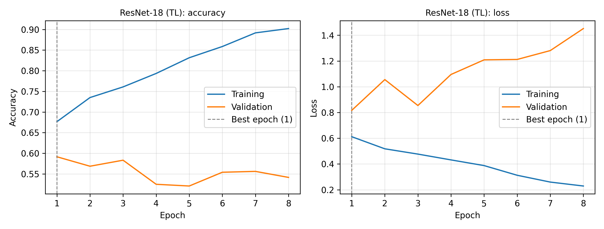
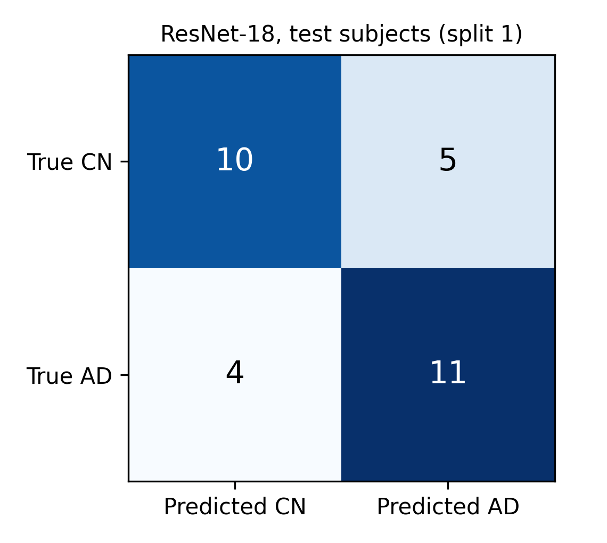
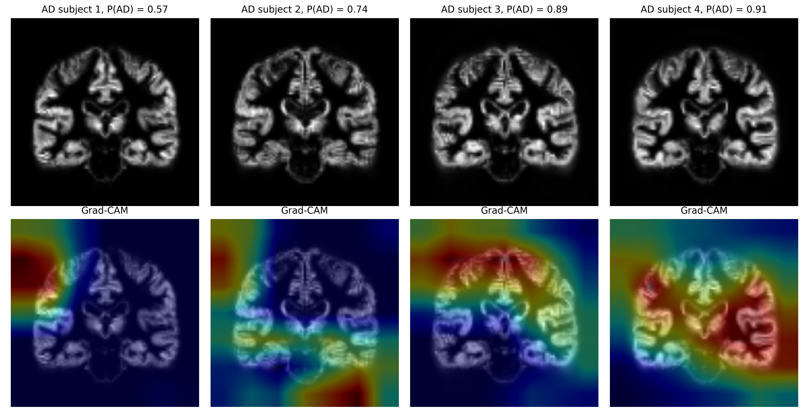

# Alzheimer's Disease Detection from Brain MRI with CNNs and Transfer Learning

Course project for LEEN364 Deep Learning and Classification Techniques (Istanbul Arel University).

The project classifies brain MRI of older adults as cognitively normal (CN) or Alzheimer's disease (AD). It compares a CNN trained from scratch with an ImageNet pre-trained ResNet-18 fine-tuned on MRI slices, and it measures how much a slice-level data split (data leakage) inflates the reported accuracy compared with a correct subject-level split.

## Method

- **Data:** OASIS-1 cross-sectional dataset, grey matter maps provided by nilearn (`fetch_oasis_vbm`). Subjects aged 60 or older with an available Clinical Dementia Rating (CDR): CDR 0 = CN, CDR >= 0.5 = AD.
- **Input:** 16 consecutive coronal slices per subject covering the hippocampal region (MNI y = -40 to -10 mm), resized to 224 x 224.
- **Split:** stratified subject-level split 70 / 15 / 15, repeated with 5 random seeds. All slices of a subject stay in the same set.
- **Models:** baseline CNN (4 conv blocks, 32-64-128-256 filters, global average pooling, dropout) and ResNet-18 pre-trained on ImageNet.
- **Training:** Adam, class-weighted cross-entropy, data augmentation (rotation, translation, horizontal flip, intensity changes), learning-rate reduction on plateau, early stopping on validation loss.
- **Decision:** the subject-level prediction is the mean AD probability of the subject's slices.
- **Evaluation:** accuracy, balanced accuracy, sensitivity, specificity, F1-score and ROC-AUC (mean ± std over the 5 splits).
- **Data leakage experiment:** ResNet-18 trained with a slice-level random split, compared with the subject-level split.
- **Interpretability:** Grad-CAM on the last convolutional block of ResNet-18.

## Data

The OASIS data are not included in this repository. Access requires accepting the OASIS Data Use Agreement (https://sites.wustl.edu/oasisbrains/).

Data were provided by OASIS-1: Cross-Sectional: Principal Investigators: D. Marcus, R. Buckner, J. Csernansky, J. Morris; P50 AG05681, P01 AG03991, P01 AG026276, R01 AG021910, P20 MH071616, U24 RR021382.

## Usage

1. Download OASIS-1 with nilearn (`nilearn.datasets.fetch_oasis_vbm()`).
2. Create the compact slice file locally:

   ```
   pip install numpy nibabel pandas matplotlib
   python scripts/prepare_oasis1.py --data_dir ~/nilearn_data/oasis1
   ```

3. Run all experiments (a GPU is recommended, for example Google Colab with `notebooks/colab_run.ipynb`):

   ```
   pip install -r requirements.txt
   python run_all.py --data oasis1_slices.npz
   ```

All settings are in `configs/default.yaml`. Results are written to `outputs/` (`results_summary.md`, `metrics/`, `logs/`, `figures/`).

## Project structure

```
configs/default.yaml        settings and hyperparameters
scripts/prepare_oasis1.py   cohort selection and slice extraction (runs locally)
src/data.py                 dataset, subject-level and slice-level splits
src/models.py               baseline CNN and ResNet-18
src/train.py                training loop with early stopping
src/evaluate.py             predictions, subject-level aggregation, metrics
src/gradcam.py              Grad-CAM
src/figures.py              figures for the report
run_all.py                  runs every experiment and writes the summary
notebooks/colab_run.ipynb   Google Colab runner
```

## Results

Cohort: 198 subjects (98 CN, 100 AD). Mean ± standard deviation over 5 subject-level splits, test sets of 15 CN + 15 AD subjects. Trained on Google Colab (NVIDIA Tesla T4), 33 minutes for all runs.

**Subject-level test results (%)**

| Model | Balanced accuracy | Sensitivity | Specificity | F1-score | AUC |
|---|---|---|---|---|---|
| Baseline CNN | 59.3 ± 8.3 | 54.7 ± 18.5 | 64.0 ± 7.6 | 56.1 ± 14.1 | 0.65 ± 0.11 |
| ResNet-18 (transfer learning) | 60.7 ± 5.5 | 57.3 ± 10.1 | 64.0 ± 3.7 | 59.0 ± 7.3 | 0.70 ± 0.04 |

**Data leakage experiment (ResNet-18, slice-level test accuracy)**

| Split strategy | Accuracy (%) |
|---|---|
| Subject-level split (correct) | 62.7 ± 1.9 |
| Slice-level split (leakage) | 89.5 ± 2.4 |

The slice-level split inflates the accuracy by 26.8 percentage points, because slices of the same subject appear in both the training and the test set. With a correct subject-level split, both models perform moderately, ResNet-18 overfits after one or two epochs, and most errors are very mild AD cases (CDR 0.5).





## License

MIT
